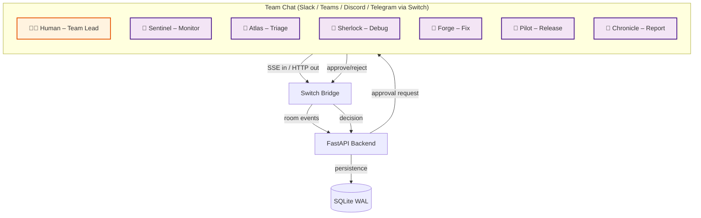

# 🚨 OpsPilot — AI Incident Command Center

> **Jab production down ho, jawab kitni der mein milega?**  
> OpsPilot ek AI-powered incident management system hai jo problem ko **detect → triage → debug → approve → resolve** tak le jaata hai — aur har destructive action se pehle **insaan ki approval** leta hai.

Built for **Flip the Switch Hackathon — WeMakeDevs × DevTools Academy × Switch+**  
**Submission deadline:** 7 Nov 2026, 11:59 PM IST · **Track:** 01 — Best Business Workflow  
**Prize pool:** $10,000 · **Team:** ShiftSpark (`codeTDMNJT`) · 4/4 members

---

[](https://wemakedevs.org/)
[](https://react.dev/)
[](https://fastapi.tiangolo.com/)
[](https://www.sqlite.org/)
[](https://switch.dev/)
[](LICENSE)

---

## 📌 Elevator Pitch

Production incident aaya? Pata chalne mein 10 minute, root cause dhoondhne mein 30 minute, aur rollback karwane ke liye manager ki approval mein aur 15 minute. **Total downtime: ~1 hour.**

OpsPilot ye sab **5 minute mein** kar deta hai — AI agents detect karte hain, triage karte hain, root cause nikaalte hain, aur human approval ke baad auto-resolve karte hain. Sab kuch ek dashboard par, real-time.

---

## 🎯 The Challenge (Flip the Switch Hackathon)

Take an AI agent you already use (**Claude Code, Codex, Cursor, OpenCode, Antigravity**), connect it to **Slack, Teams, Discord or Telegram** with **Switch**, and build a workflow where it gets real work done with your teammates.

**OpsPilot is our answer:** an incident command center where AI agents and humans work together in a **Switch-powered War Room** to detect, triage, debug, approve and resolve production incidents — without leaving the chat.

---

## 🧩 How Switch Is Used (Central to the Project)

Switch is not an add-on — it is the **communication backbone**. Without Switch, the agent-to-human workflow stops working.

| Switch Concept | How OpsPilot Uses It |
|----------------|----------------------|
| **Room = Channel** | Every incident gets a `#incident-war-room-<id>` room where agents + humans live |
| **Agent as teammate** | Sentinel, Atlas, Sherlock, Forge, Pilot, Chronicle join the room like any other teammate |
| **Shared log** | Every alert, triage decision, root cause, and approval is written to the room — everyone reads from the same log |
| **Agent protocol (SSE in, HTTP out)** | Backend emits agent events via Switch SSE; chat messages come in as HTTP POST |
| **Bridge** | `switch_client.py` posts `incident.opened`, `approval.requested`, `approval.decided`, `action.executed`, `chat.message` to Switch |
| **Human in the loop** | Team lead approves/rejects rollback from the chat room — `{"decision":"approve"}` flows back through Switch |

**Without Switch:** no War Room, no agent-human handoff, no chat-based approval — the incident cannot be resolved.

---

## 📽️ 30-Second Demo (Judges Ko Yahi Dikhao)

```text
1. Dashboard kholo → Live Incidents, AI Agents, Switch Bridge sab live
2. Top-right "⚡ Simulate Production Alert" click karo
3. Auto flow chalta hai (Switch room mein real-time):
   ├── Step 1 — Detection: Sentinel alert detect karta hai (HTTP 500 flood)
   ├── Step 2 — AI Triage: Atlas severity + blast radius identify karta hai
   ├── Step 3 — Debugging: Sherlock repro banata hai, root cause nikaalta hai
   ├── Step 4 — Approval: Fix staged, insaan ke approve ka wait (chat room mein)
   └── Step 5 — Resolution: Approve & Execute → Pilot rollback → Incident Resolved
4. Approval Center → "Approve & Execute" → rollback chalu → resolved
5. War Room → AI agents aur team ki live chat (Switch routed)
6. Analytics → MTTR, severity split, agent productivity charts
```

> 🎥 **Demo Video:** _(Loom / YouTube link yahan daalo — judging mein "Presentation" 25% weightage hai)_  
> 🖼️ **Screenshots:** `docs/screenshots/` mein daalo  
> 📋 **Demo Script:** `docs/demo-script.md` (step-by-step narrator guide)

---

## ✨ Features (Track 01: Best Business Workflow)

| # | Feature | Kya Karta Hai | Status |
|---|---------|---------------|--------|
| 1 | 🔍 **Sentinel (Monitor)** | Alerts detect karta hai (HTTP 500 flood) | ✅ |
| 2 | 🎯 **Atlas (Triage)** | Severity + blast radius identify karta hai | ✅ |
| 3 | 🕵️ **Sherlock (Debug)** | Logs se root cause nikaalta hai | ✅ |
| 4 | 🛠️ **Forge (Fix)** | Rollback plan propose karta hai | ✅ |
| 5 | 🚀 **Pilot (Release)** | Human approve ke baad action execute karta hai | ✅ |
| 6 | 📋 **Chronicle (Report)** | Postmortem + MTTR report generate karta hai | ✅ |
| 7 | 👤 **Human Approval Gate** | Approve / Reject, double-decision blocked | ✅ |
| 8 | 💬 **Switch War Room** | Agents + humans same room, shared log | ✅ |
| 9 | 📊 **Analytics** | MTTR, trends, agent productivity charts | ✅ |
| 10 | ⚡ **Simulate Alert** | One-click production alert simulation | ✅ |

---

## 🏗️ Architecture



**Workflow:** `alert → Sentinel (Switch room) → Atlas triage → Sherlock debug → Forge plan → Human approve (chat) → Pilot execute → Chronicle report`

---

## 🛠️ Tech Stack

| Layer | Tech | Version |
|-------|------|---------|
| **Frontend** | React 18 + Vite + Tailwind CSS 4 + Recharts + React Router | Latest |
| **Backend** | Python + FastAPI + Uvicorn | 3.14 / 0.115+ |
| **Database** | SQLite (WAL mode) | `backend/opspilot.db` |
| **AI Agents** | OpenCode + Codex (simulated in `backend/pipeline.py`) | — |
| **Integration** | Switch+ (simulated default, live via env vars) | — |
| **Charts** | Recharts | — |
| **UI Styling** | Glassmorphism, Tailwind CSS 4, Custom animations | — |

---

## 🚀 Quick Start (2 Commands)

### Option A — Production Build (Ek Hi Server, Sabse Easy)

```powershell
# 1) Frontend build (ek hi baar)
cd frontend ; npm install ; npm run build ; cd ..

# 2) Backend deps install
cd backend
python -m pip install -r requirements.txt

# 3) Server start
python -m uvicorn main:app --host 127.0.0.1 --port 8000
```

Browser kholo → **http://127.0.0.1:8000** 🎉

### Option B — Development Mode (Hot Reload)

```powershell
.\start.ps1   # ek terminal mein backend + vite dev dono
```

- Backend : `http://127.0.0.1:8000` (API + Swagger docs)
- Frontend: `http://localhost:5173` (hot reload UI)

---

## 🔧 Environment Variables

| Variable | Default | Description |
|----------|---------|-------------|
| `SWITCH_MODE` | `simulated` | `simulated` ya `connected` |
| `SWITCH_WEBHOOK_URL` | — | Switch live webhook URL |
| `SWITCH_SERVER_URL` | — | Alternate Switch server URL |
| `PORT` | `8000` | Backend server port |

Live Switch mode example:

```powershell
$env:SWITCH_MODE = "connected"
$env:SWITCH_WEBHOOK_URL = "https://your-switch-server/webhook"
python -m uvicorn main:app --port 8000
```

---

## 📡 API Reference

| Method | Endpoint | Kaam |
|--------|----------|------|
| GET | `/api/health` | Health check |
| GET | `/api/stats` | Dashboard KPIs |
| GET | `/api/incidents?status=&q=` | Incident list + timeline |
| GET | `/api/incidents/{id}` | Single incident + events + approval |
| POST | `/api/incidents` | ⚡ Simulate production alert |
| GET | `/api/agents` | AI agents + live status |
| GET / POST | `/api/tasks`, `/api/tasks/{id}` | Task manager |
| GET | `/api/approvals?status=` | Approval center |
| POST | `/api/approvals/{id}/decision` | `{"decision":"approve"}` / `"reject"` |
| GET / POST | `/api/messages` | War room chat |
| GET | `/api/analytics` | MTTR, trends, agent performance |
| GET | `/api/switch` | Switch bridge status + event log |

Open API docs: **http://127.0.0.1:8000/docs**

---

## 📁 Project Structure

```
OpsPilot/
├── backend/
│   ├── main.py           # FastAPI routes + SPA serving
│   ├── pipeline.py       # Incident state machine (5 stages) ← dil
│   ├── switch_client.py  # Switch integration layer
│   ├── db.py             # SQLite schema + helpers
│   ├── seed.py           # Agents, historical incidents, war room
│   ├── requirements.txt
│   └── opspilot.db       # SQLite database (auto-generated)
├── frontend/
│   ├── src/
│   │   ├── pages/        # Overview, Incidents, IncidentDetail, Agents,
│   │   │                 # WarRoom, Tasks, Approvals, Analytics
│   │   ├── components/   # Sidebar, Topbar, Timeline, UI (Avatar, Button, Input, etc.)
│   │   ├── api.js  hooks.js  constants.js  App.jsx
│   │   └── index.css     # Glassmorphism + animations
│   ├── dist/             # Built SPA (served by backend in prod)
│   ├── vite.config.js
│   └── package.json
├── docs/
│   ├── screenshots/      # Demo screenshots daalo yahan
│   └── demo-script.md    # Demo narrator guide
├── start.ps1             # Dev mode: backend + frontend together
└── README.md
```

---

## 👥 Team Division (4 Members — ShiftSpark)

| Member | Responsibility | Code Kahan Hai |
|--------|----------------|----------------|
| **Vansh Kesharwani (Leader)** | Frontend – Dashboard UI | `frontend/src/**` |
| **Brijesh Maurya** | Backend – APIs + DB | `backend/main.py`, `db.py` |
| **Kartikey Kesarwani** | AI Agents – OpenCode/Codex | `backend/pipeline.py` |
| **Kajal Kesharwani** | Switch integration + demo QA | `backend/switch_client.py` |

---

## 🧪 Tested Flow (Already Verified)

```text
Simulate alert → #9 detected → triage (3.5s) → debug + root cause (6.5s)
→ approval pending → POST decision=approve → rollback executes (5s)
→ status=resolved, MTTR recorded, 14 Switch events, 16 war-room messages
→ POST decision=reject on #10 → status=blocked → double decide → HTTP 400
```

---

## 🏆 Judging Criteria (Flip the Switch)

| Criterion | Weight | How OpsPilot Meets It |
|-----------|--------|----------------------|
| **Use of Switch** | High | Switch is the communication backbone — War Room = Switch room, agents = teammates, approval flows through Switch |
| **Technical execution** | High | Reproducible: clone → `npm install && build` → `pip install -r requirements.txt` → `uvicorn main:app` |
| **Creativity & impact** | Medium | Real business problem: production incident MTTR reduced from ~1 hour to ~5 minutes |
| **Presentation** | Medium | Demo video + this README clearly show how Switch is used |

---

## 🔮 Future Scope (Post-Hackathon)

- [ ] Live Switch webhook (connected mode by default)
- [ ] Real log scraping + real deployment rollback
- [ ] Email / Slack / Teams notifications on approval
- [ ] Auth + RBAC (admin / engineer / viewer roles)
- [ ] Auto-escalation page on-call engineer

---

## 🤝 Contributing

1. Fork the repo
2. Create your feature branch: `git checkout -b feature/your-feature`
3. Commit your changes: `git commit -m "feat: your feature"`
4. Push to the branch: `git push origin feature/your-feature`
5. Open a pull request

---

## 📄 License

MIT — Built for Flip the Switch Hackathon (WeMakeDevs × DevTools Academy × Switch).

---

## 🙏 Acknowledgments

- **WeMakeDevs** — Hackathon platform
- **DevTools Academy** — Mentorship & resources
- **Switch+** — Agent communication bridge
- **OpenCode / Codex** — AI agent reasoning

---

> Made with ❤️ by Team OpsPilot · ShiftSpark  
> *Jab production down ho, jawab kitni der mein milega?*