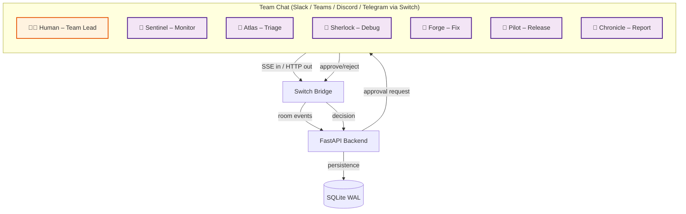

# 🚨 OpsPilot — AI Incident Command Center

> **Jab production down ho, jawab kitni der mein milega?**  
> OpsPilot ek AI-powered incident management system hai jo problem ko **detect → triage → debug → approve → resolve** tak le jaata hai — aur har destructive action se pehle **insaan ki approval** leta hai.

Built for **Flip the Switch Hackathon — WeMakeDevs × DevTools Academy × Switch+**  
**Submission deadline:** 7 Nov 2026, 11:59 PM IST · **Track:** 01 — Best Business Workflow  
**Prize pool:** $10,000 · **Team:** ShiftSpark (`codeTDMNJT`) · 4/4 members

---

[](https://wemakedevs.org/)
[](https://react.dev/)
[](https://fastapi.tiangolo.com/)
[](https://www.sqlite.org/)
[](https://switch.dev/)
[](LICENSE)

---

## 📸 Project Screenshots

> Add your actual screenshots to `docs/screenshots/` folder:

| File | Description |
|------|-------------|
| `docs/screenshots/dashboard.png` | Overview dashboard with live incidents and AI agent status |
| `docs/screenshots/incidents.png` | Live incidents list with severity and status filters |
| `docs/screenshots/incident-detail.png` | Single incident detail with 5-stage workflow timeline |
| `docs/screenshots/agents.png` | AI Agents page showing Sentinel, Atlas, Sherlock, Forge, Pilot, Chronicle |
| `docs/screenshots/war-room.png` | War Room chat interface routed through Switch bridge |
| `docs/screenshots/approvals.png` | Approval Center with human approve/reject buttons |
| `docs/screenshots/analytics.png` | Analytics with MTTR charts, severity split, agent productivity |
| `docs/screenshots/demo-flow.png` | End-to-end demo flow visualization |

**Demo video:** Add Loom/YouTube link here → _(Link daalo)_

---

## 🎯 Project Overview (Flip the Switch Hackathon)

### The Challenge

Take an AI agent you already use (**Claude Code, Codex, Cursor, OpenCode, Antigravity**), connect it to **Slack, Teams, Discord or Telegram** with **Switch**, and build a workflow where it gets real work done with your teammates.

### What OpsPilot Builds

OpsPilot is an **AI Incident Command Center** where AI agents and humans collaborate in a **Switch-powered War Room** to manage the complete production incident lifecycle:

```
Alert → Sentinel → Atlas → Sherlock → Forge → Human Approval → Pilot → Chronicle
```

Every stage travels through Switch — agents act as teammates in chat rooms, humans approve destructive actions, and the full audit trail lives in the shared Switch log.

---

## 🏗️ Architecture



### Data Flow

1. **Detection** — Sentinel monitors metrics and detects anomalies (HTTP 500 flood)
2. **Triage** — Atlas classifies severity and isolates blast radius
3. **Debug** — Sherlock builds repro cases and identifies root cause
4. **Fix** — Forge proposes a rollback plan with risk assessment
5. **Approval** — Human team lead reviews and approves/rejects via Switch chat
6. **Execute** — Pilot executes the approved rollback
7. **Report** — Chronicle generates postmortem and MTTR report

---

## 🤖 AI Agents (6 Specialized Agents)

| Agent | Role | Responsibilities | Switch Addressing |
|-------|------|------------------|-------------------|
| **Sentinel** | Monitor | Scrape metrics + logs, detect anomalies, page oncall | anyone |
| **Atlas** | Triage | Classify severity, isolate blast radius, draft incident summary | owner-agents |
| **Sherlock** | Debug | Build repro cases, correlate traces, identify root cause | owner-agents |
| **Forge** | Fix | Propose code fix, generate rollback plan, estimate risk | owner-agents |
| **Pilot** | Release | Execute approved rollouts, verify after deploy, report MTTR | owner-agents |
| **Chronicle** | Report | Write postmortem, update stakeholders, archive evidence | owner-agents |

### Agent Status States
- **Working** — Agent is actively processing an incident
- **Idle** — Agent is waiting for work
- **Thinking** — Agent is analyzing data

---

## 🔌 Switch Integration (Core Infrastructure)

Switch is the **communication backbone** of OpsPilot. Without Switch, the agent-to-human workflow cannot function.

### Switch Concepts Used

| Concept | Implementation in OpsPilot |
|---------|---------------------------|
| **Room = Channel** | Every incident gets `#incident-war-room-<id>` where agents + humans live |
| **Agent as teammate** | All 6 agents join rooms like human teammates with name + avatar |
| **Shared log** | All alerts, triage decisions, root causes, approvals written to room log |
| **Agent protocol** | SSE in / HTTP out — backend emits agent events via Switch SSE |
| **Bridge** | `switch_client.py` posts events: `incident.opened`, `approval.requested`, `approval.decided`, `action.executed`, `chat.message` |
| **Human in loop** | Team lead approves/rejects rollback from chat — decision flows back through Switch |

### Events Posted to Switch

```
incident.opened     → When a new incident is simulated
approval.requested  → When Forge stages a fix needing human approval
approval.decided    → When human approves or rejects
action.executed     → When Pilot executes rollback
chat.message        → When any participant sends a message
```

### Modes
- **Simulated (default)** — Events recorded locally in `switch_log` table, demo never breaks
- **Live (connected)** — Set `SWITCH_MODE=connected` + `SWITCH_WEBHOOK_URL` for real Switch delivery

---

## 📱 Frontend Pages (8 Pages)

### 1. Overview (Dashboard)
- System health status (uptime, MTTR, active agents)
- Live incidents list with severity badges
- AI agent status overview
- Switch bridge mode indicator
- Recent incident feed
- One-click "Simulate Production Alert" button

### 2. Live Incidents
- Filterable incident table (All / Active / Awaiting Approval / Resolved)
- Search by service or title
- Severity-based sorting (Critical → High → Medium → Low)
- Click to view incident details

### 3. Incident Detail
- 5-stage workflow timeline (Detect → Triage → Debug → Approve → Resolve)
- Root cause analysis from Sherlock
- Proposed fix from Forge with rollback command
- Approval gate with Approve/Reject buttons
- Console output log with color-coded levels

### 4. AI Agents
- 6 agent cards with capabilities list
- Current task status per agent
- Task completion counts
- Agent orchestration flow visualization
- Switch delivery health metrics

### 5. War Room
- Live chat between team and AI agents
- Role-based message styling (AI Agent = cyan, Human = violet, System = amber)
- Switch event log sidebar
- Bridge configuration display
- Message input with send functionality

### 6. Task Manager
- Kanban-style columns: Queued / Running / Done / Failed
- Priority badges (P0 / P1 / P2)
- Click to advance task status
- Incident linkage per task

### 7. Approval Center
- Pending / Approved / Rejected tabs
- Risk level display (High / Medium / Low)
- Approve & Execute button (human-in-the-loop gate)
- Reject button with reason
- Decision history with timestamps

### 8. Analytics
- MTTR trend over time
- Incident volume charts
- Severity split pie chart
- Status distribution
- Agent productivity bar chart
- Service reliability table
- Postmortem summary numbers

---

## 🛠️ Tech Stack

| Layer | Technology | Version | Purpose |
|-------|-----------|---------|---------|
| **Frontend** | React 18 + Vite | ^18.3.1 | UI framework + build tool |
| **Styling** | Tailwind CSS 4 | ^4.0.0 | Utility-first CSS |
| **Charts** | Recharts | ^2.13.3 | Data visualization |
| **Routing** | React Router DOM | ^6.26.2 | Client-side routing |
| **Backend** | FastAPI + Uvicorn | Latest | Python web framework |
| **Database** | SQLite (WAL mode) | — | Incident persistence |
| **AI Agents** | OpenCode + Codex | — | Simulated agent reasoning |
| **Integration** | Switch+ | — | Agent-team communication |
| **Icons** | Unicode emojis | — | Visual indicators |

---

## 🚀 Quick Start

### Prerequisites
- Python 3.13+
- Node.js 18+
- npm

### Option A — Production Build (Single Server)

```powershell
# 1) Clone the repository
git clone https://github.com/itsVanshKesharwani/OpsPilot.git
cd OpsPilot

# 2) Build frontend (one-time)
cd frontend
npm install
npm run build
cd ..

# 3) Install backend dependencies
cd backend
python -m pip install -r requirements.txt

# 4) Start the server
python -m uvicorn main:app --host 127.0.0.1 --port 8000
```

Open browser → **http://127.0.0.1:8000** 🎉

### Option B — Development Mode (Hot Reload)

```powershell
.\start.ps1
```

- Backend : `http://127.0.0.1:8000` (API + Swagger docs at `/docs`)
- Frontend: `http://localhost:5173` (hot reload UI)

### Option C — Live Switch Mode

```powershell
$env:SWITCH_MODE = "connected"
$env:SWITCH_WEBHOOK_URL = "https://your-switch-server/webhook"
python -m uvicorn main:app --port 8000
```

---

## 📡 API Reference

All endpoints are under `/api/`:

| Method | Endpoint | Description | Body |
|--------|----------|-------------|------|
| GET | `/api/health` | Health check | — |
| GET | `/api/stats` | Dashboard KPIs | — |
| GET | `/api/incidents?status=&q=` | Incident list + timeline | — |
| GET | `/api/incidents/{id}` | Single incident + events + approval | — |
| POST | `/api/incidents` | ⚡ Simulate production alert | `{title, service, severity, description, environment}` |
| GET | `/api/agents` | AI agents + live status | — |
| GET | `/api/tasks` | List all tasks | — |
| POST | `/api/tasks/{id}` | Update task status | `{status}` |
| GET | `/api/approvals?status=` | Approval center | — |
| POST | `/api/approvals/{id}/decision` | Approve or reject | `{decision: "approve\|reject", approver: "string"}` |
| GET | `/api/messages` | War room chat messages | — |
| POST | `/api/messages` | Send war room message | `{author, role, content}` |
| GET | `/api/analytics` | MTTR, trends, agent performance | — |
| GET | `/api/switch` | Switch bridge status + event log | — |

**Swagger UI:** http://127.0.0.1:8000/docs

---

## 📁 Project Structure

```
OpsPilot/
├── backend/
│   ├── main.py           # FastAPI routes + SPA serving
│   ├── pipeline.py       # Incident state machine (5 stages)
│   ├── switch_client.py  # Switch integration layer
│   ├── db.py             # SQLite schema + helpers
│   ├── seed.py           # Agents, historical incidents, war room
│   ├── requirements.txt
│   └── opspilot.db       # SQLite database (auto-generated)
├── frontend/
│   ├── src/
│   │   ├── pages/
│   │   │   ├── Overview.jsx      # Dashboard with stats + live incidents
│   │   │   ├── Incidents.jsx     # Filterable incident table
│   │   │   ├── IncidentDetail.jsx # 5-stage workflow + approval
│   │   │   ├── Agents.jsx        # 6 AI agents + capabilities
│   │   │   ├── WarRoom.jsx       # Switch-powered chat
│   │   │   ├── Tasks.jsx         # Task manager kanban
│   │   │   ├── Approvals.jsx     # Human approval center
│   │   │   └── Analytics.jsx     # MTTR + charts
│   │   ├── components/
│   │   │   ├── Sidebar.jsx       # Navigation with pending counts
│   │   │   ├── Topbar.jsx        # Simulate alert + clock + toast
│   │   │   ├── Timeline.jsx      # 5-stage workflow timeline
│   │   │   └── ui.jsx            # Reusable UI components
│   │   ├── api.js                # API client
│   │   ├── hooks.js              # usePoll, timeAgo, fmtClock
│   │   ├── constants.js          # SEVERITY, STATUS, AGENT_STATUS, STAGES
│   │   ├── App.jsx               # Router + layout
│   │   ├── main.jsx              # Entry point
│   │   └── index.css             # Glassmorphism + animations
│   ├── dist/                     # Built SPA
│   ├── vite.config.js
│   └── package.json
├── docs/
│   ├── screenshots/              # Add demo screenshots here
│   └── demo-script.md            # Demo narrator guide
├── start.ps1                     # Dev mode startup script
└── README.md
```

---

## 👥 Team Division (4 Members — ShiftSpark)

| Member | GitHub | Responsibility | Code Location |
|--------|--------|----------------|---------------|
| **Vansh Kesharwani (Leader)** | @vanshkes | Frontend – Dashboard UI | `frontend/src/pages/`, `frontend/src/components/` |
| **Brijesh Maurya** | @shubh.ai | Backend – APIs + DB | `backend/main.py`, `backend/db.py` |
| **Kartikey Kesarwani** | @kartikeyk | AI Agents – OpenCode/Codex | `backend/pipeline.py` |
| **Kajal Kesharwani** | @kajalkesharwani | Switch integration + demo QA | `backend/switch_client.py` |

**Team Code:** `codeTDMNJT`

---

## 🧪 Tested Flow (Already Verified)

```text
Simulate alert → #9 detected → triage (3.5s) → debug + root cause (6.5s)
→ approval pending → POST decision=approve → rollback executes (5s)
→ status=resolved, MTTR recorded, 14 Switch events, 16 war-room messages
→ POST decision=reject on #10 → status=blocked → double decide → HTTP 400
```

### Manual Test Checklist

- [ ] Simulate Production Alert creates incident #9+
- [ ] Sentinel detects HTTP 500 flood
- [ ] Atlas triages severity + blast radius
- [ ] Sherlock identifies root cause
- [ ] Forge proposes rollback plan
- [ ] Approval Center shows pending approval
- [ ] Clicking "Approve & Execute" changes status to resolved
- [ ] Clicking "Reject" changes status to blocked
- [ ] War Room shows agent messages
- [ ] Analytics updates MTTR after resolution

---

## 🏆 Judging Criteria (Flip the Switch)

| Criterion | Weight | How OpsPilot Meets It |
|-----------|--------|----------------------|
| **Use of Switch** | High | Switch is the communication backbone — War Room = Switch room, agents = teammates, approval flows through Switch SSE/HTTP |
| **Technical execution** | High | Reproducible: clone → `npm install && build` → `pip install -r requirements.txt` → `uvicorn main:app` |
| **Creativity & impact** | Medium | Real business problem: production incident MTTR reduced from ~1 hour to ~5 minutes |
| **Presentation** | Medium | Demo video + comprehensive README clearly show Switch integration |

---

## 🔮 Future Scope (Post-Hackathon)

- [ ] Live Switch webhook (connected mode by default)
- [ ] Real log scraping + real deployment rollback
- [ ] Email / Slack / Teams notifications on approval
- [ ] Auth + RBAC (admin / engineer / viewer roles)
- [ ] Auto-escalation page on-call engineer
- [ ] Mobile responsive improvements
- [ ] Dark/light theme toggle

---

## 🤝 Contributing

1. Fork the repository
2. Create your feature branch: `git checkout -b feature/your-feature`
3. Commit your changes: `git commit -m "feat: your feature description"`
4. Push to the branch: `git push origin feature/your-feature`
5. Open a pull request against `main`

---

## 📄 License

MIT License — Built for Flip the Switch Hackathon (WeMakeDevs × DevTools Academy × Switch).

---

## 🙏 Acknowledgments

- **WeMakeDevs** — Hackathon platform and community
- **DevTools Academy** — Mentorship and resources
- **Switch+** — Agent communication bridge infrastructure
- **OpenCode / Codex** — AI agent reasoning and code generation

---

> Made with ❤️ by Team OpsPilot · ShiftSpark  
> *Jab production down ho, jawab kitni der mein milega?*