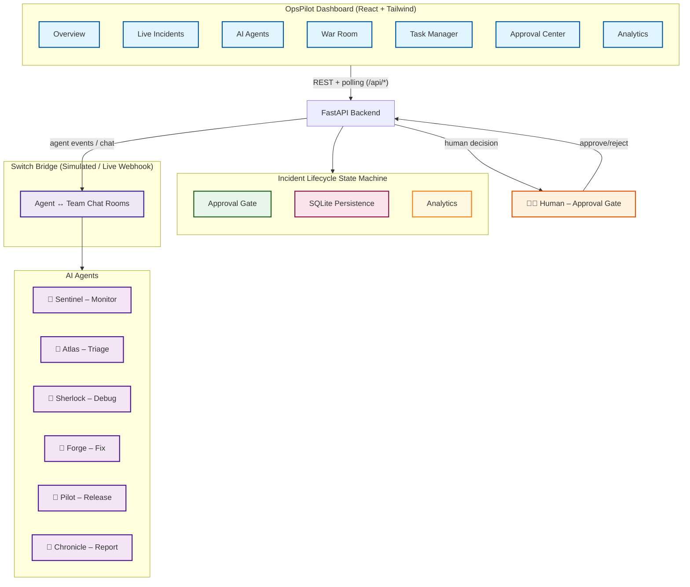

# 🚨 OpsPilot — AI Incident Command Center

> **Jab production down ho, jawab kitni der mein milega?**  
> OpsPilot ek AI-powered incident management system hai jo problem ko **detect → triage → debug → approve → resolve** tak le jaata hai — aur har destructive action se pehle **insaan ki approval** leta hai.

Built for **WeMakeDevs × DevTools Academy × Switch+** hackathon · Submission deadline: **7 Nov 2026, 11:59 PM IST**

---

[](https://react.dev/)
[](https://fastapi.tiangolo.com/)
[](https://www.sqlite.org/)
[](https://switch.dev/)
[](LICENSE)
[](https://wemakedevs.org/)

---

## 📌 Elevator Pitch

Production incident aaya? Pata chalne mein 10 minute, root cause dhoondhne mein 30 minute, aur rollback karwane ke liye manager ki approval mein aur 15 minute. **Total downtime: ~1 hour.**

OpsPilot ye sab **5 minute mein** kar deta hai — AI agents detect karte hain, triage karte hain, root cause nikaalte hain, aur human approval ke baad auto-resolve karte hain. Sab kuch ek dashboard par, real-time.

---

## 🎯 Problem Statement

| Problem | Asli Dard | OpsPilot Solution |
|---------|-----------|-------------------|
| 🔴 Alert flood | Kai alerts ek saath, kya critical hai pata nahi chalta | **Atlas** severity + blast radius triage karta hai |
| 🔴 Root cause khojne mein der | Logs manually dhoondhne padte hain | **Sherlock** logs analyze karke root cause nikaalta hai |
| 🔴 Destructive action bina approval | Rollback / deploy ke liye manager ka wait | **Human Approval Gate** — bina approve ke kuch nahi chalta |
| 🔴 Team coordination fail | Chat scattered hai, koi update nahi | **Switch-powered War Room** — sab events aur messages ek jagah |
| 🔴 MTTR pata nahi chalta | Kaunsa kitna time le raha hai? | **Analytics** — MTTR, severity split, agent productivity |

---

## ✨ Key Features

| # | Feature | Kya Karta Hai | Status |
|---|---------|---------------|--------|
| 1 | 🔍 **Sentinel** | Monitoring se alerts detect karta hai (HTTP 500 flood etc.) | ✅ |
| 2 | 🎯 **Atlas** | Severity + blast radius identify karta hai | ✅ |
| 3 | 🕵️ **Sherlock** | Logs se root cause nikaalta hai, repro banata hai | ✅ |
| 4 | 🛠️ **Forge** | Fix / rollback plan propose karta hai | ✅ |
| 5 | 🚀 **Pilot** | Insaan ki approve ke baad action execute karta hai | ✅ |
| 6 | 📋 **Chronicle** | Postmortem + MTTR report generate karta hai | ✅ |
| 7 | 👤 **Human Approval Gate** | Approve / Reject, double-decision blocked | ✅ |
| 8 | 💬 **War Room** | Switch ke through live agent + team chat | ✅ |
| 9 | 📊 **Analytics** | MTTR, trends, agent productivity charts | ✅ |
| 10 | ⚡ **Simulate Alert** | One-click production alert simulation | ✅ |

---

## 📽️ 30-Second Demo (Judges Ko Yahi Dikhao)

```text
1. Dashboard kholo → Live Incidents, AI Agents, Switch Bridge sab live
2. Top-right "⚡ Simulate Production Alert" click karo
3. Auto flow chalta hai:
   ├── Step 1 — Detection: Sentinel alert detect karta hai (HTTP 500 flood)
   ├── Step 2 — AI Triage: Atlas severity + blast radius identify karta hai
   ├── Step 3 — Debugging: Sherlock repro banata hai, root cause nikaalta hai
   ├── Step 4 — Approval: Fix staged, insaan ke approve ka wait
   └── Step 5 — Resolution: Approve & Execute → Pilot rollback → Incident Resolved
4. Approval Center → "Approve & Execute" → rollback chalu → resolved
5. War Room → AI agents aur team ki live chat (Switch routed)
6. Analytics → MTTR, severity split, agent productivity charts
```

> 🎥 **Demo Video:** _(Loom / YouTube link yahan daalo)_  
> 🖼️ **Screenshots:** `docs/screenshots/` mein daalo

---

## 🏗️ Architecture



**Workflow:** `alert → backend → Switch → AI agents → dashboard → human approval → rollback → incident resolved`

---

## 🛠️ Tech Stack

| Layer | Tech | Version |
|-------|------|---------|
| **Frontend** | React 18 + Vite + Tailwind CSS 4 + Recharts + React Router | Latest |
| **Backend** | Python + FastAPI + Uvicorn | 3.14 / 0.115+ |
| **Database** | SQLite (WAL mode) | `backend/opspilot.db` |
| **AI Agents** | OpenCode + Codex (simulated in pipeline) | — |
| **Integration** | Switch+ (simulated default, live via env vars) | — |
| **Charts** | Recharts | — |

---

## 🚀 Quick Start (2 Commands)

### Option A — Production Build (Ek Hi Server, Sabse Easy)

```powershell
# 1) Frontend build (ek hi baar)
cd frontend ; npm install ; npm run build ; cd ..

# 2) Backend deps install
cd backend
python -m pip install -r requirements.txt

# 3) Server start
python -m uvicorn main:app --host 127.0.0.1 --port 8000
```

Browser kholo → **http://127.0.0.1:8000** 🎉

### Option B — Development Mode (Hot Reload)

```powershell
.\start.ps1   # ek terminal mein backend + vite dev dono
```

- Backend : `http://127.0.0.1:8000` (API + Swagger docs)
- Frontend: `http://localhost:5173` (hot reload UI)

---

## 🔧 Environment Variables

| Variable | Default | Description |
|----------|---------|-------------|
| `SWITCH_MODE` | `simulated` | `simulated` ya `connected` |
| `SWITCH_WEBHOOK_URL` | — | Switch live webhook URL |
| `SWITCH_SERVER_URL` | — | Alternate Switch server URL |
| `PORT` | `8000` | Backend server port |

Live Switch mode example:

```powershell
$env:SWITCH_MODE = "connected"
$env:SWITCH_WEBHOOK_URL = "https://your-switch-server/webhook"
python -m uvicorn main:app --port 8000
```

---

## 📡 API Reference

| Method | Endpoint | Kaam |
|--------|----------|------|
| GET | `/api/health` | Health check |
| GET | `/api/stats` | Dashboard KPIs |
| GET | `/api/incidents?status=&q=` | Incident list + timeline |
| GET | `/api/incidents/{id}` | Single incident + events + approval |
| POST | `/api/incidents` | ⚡ Simulate production alert |
| GET | `/api/agents` | AI agents + live status |
| GET / POST | `/api/tasks`, `/api/tasks/{id}` | Task manager |
| GET | `/api/approvals?status=` | Approval center |
| POST | `/api/approvals/{id}/decision` | `{"decision":"approve"}` / `"reject"` |
| GET / POST | `/api/messages` | War room chat |
| GET | `/api/analytics` | MTTR, trends, agent performance |
| GET | `/api/switch` | Switch bridge status + event log |

Open API docs: **http://127.0.0.1:8000/docs**

---

## 📁 Project Structure

```
OpsPilot/
├── backend/
│   ├── main.py           # FastAPI routes + SPA serving
│   ├── pipeline.py       # Incident state machine (5 stages) ← dil
│   ├── switch_client.py  # Switch integration layer
│   ├── db.py             # SQLite schema + helpers
│   ├── seed.py           # Agents, historical incidents, war room
│   ├── requirements.txt
│   └── opspilot.db       # SQLite database (auto-generated)
├── frontend/
│   ├── src/
│   │   ├── pages/        # Overview, Incidents, IncidentDetail, Agents,
│   │   │                 # WarRoom, Tasks, Approvals, Analytics
│   │   ├── components/   # Sidebar, Topbar, Timeline, UI
│   │   ├── api.js  hooks.js  constants.js  App.jsx
│   ├── dist/             # Built SPA (served by backend in prod)
│   ├── vite.config.js
│   └── package.json
├── docs/
│   └── screenshots/      # Demo screenshots daalo yahan
├── start.ps1             # Dev mode: backend + frontend together
└── README.md
```

---

## 👥 Team Division (4 Members)

| Member | Responsibility | Code Kahan Hai |
|--------|----------------|----------------|
| **Member 1** | Frontend – Dashboard UI | `frontend/src/**` (7 pages, dark theme, charts) |
| **Member 2** | Backend – APIs + DB | `backend/main.py`, `db.py` (13 endpoints, SQLite) |
| **Member 3** | AI Agents – Codex/OpenCode | `backend/pipeline.py` (triage/debug/fix agents) |
| **Member 4** | Switch integration + testing + demo | `backend/switch_client.py`, demo script, QA |

---

## 🧪 Tested Flow (Already Verified)

```text
Simulate alert → #9 detected → triage (3.5s) → debug + root cause (6.5s)
→ approval pending → POST decision=approve → rollback executes (5s)
→ status=resolved, MTTR recorded, 14 Switch events, 16 war-room messages
→ POST decision=reject on #10 → status=blocked → double decide → HTTP 400
```

---

## 🐛 Troubleshooting

| Problem | Solution |
|---------|----------|
| `ModuleNotFoundError: No module named 'fastapi'` | `cd backend && python -m pip install -r requirements.txt` |
| `pydantic-core` build fails on Python 3.14 | `pip install --upgrade "pydantic>=2.14" fastapi uvicorn[standard]` |
| Frontend blank in prod mode | Pehle `cd frontend && npm run build` karo, phir backend start karo |
| Port 8000 already in use | Doosra port use karo: `--port 8001` |
| Switch events nahi aa rahe | Confirm karo `SWITCH_MODE=connected` set hai |

---

## 🔮 Future Scope (Post-Hackathon)

- [ ] Real log scraping + real deployment rollback
- [ ] Production Switch webhook (live mode by default)
- [ ] Email / Slack notifications on approval
- [ ] Auth + RBAC (admin / engineer / viewer roles)
- [ ] Incident escalation matrix (auto-page on-call engineer)
- [ ] Mobile responsive improvements

---

## 📄 License

MIT — Built for WeMakeDevs × DevTools Academy × Switch+ hackathon.

---

## 🙏 Acknowledgments

- **WeMakeDevs** — Hackathon platform
- **DevTools Academy** — Mentorship & resources
- **Switch+** — Agent communication bridge
- **OpenCode / Codex** — AI agent reasoning

---

> Made with ❤️ by Team OpsPilot  
> *Jab production down ho, jawab kitni der mein milega?*